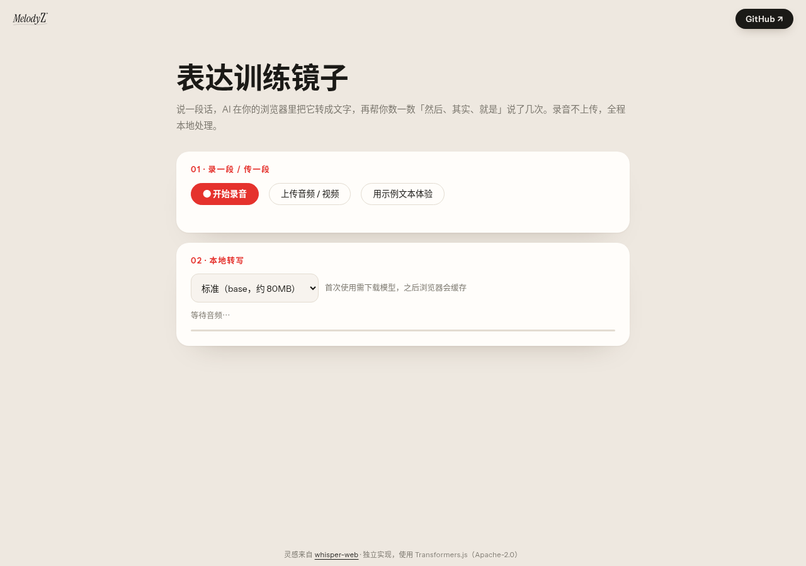

# 表达训练镜子

> 说一段话，浏览器把它转成文字，再帮你数一数「然后、其实、就是」说了几次。录音不上传，全程本地处理。

**在线体验：** https://zouyue123321.github.io/speech-mirror/

## 这是什么

一个练习口头表达的小工具：
1. 录一段话，或上传音频 / 视频（也可以用示例文本直接体验）
2. 用 Whisper 语音识别模型（通过 [Transformers.js](https://github.com/huggingface/transformers.js) 在浏览器里运行）把语音转成文字，可选 tiny（约 40MB）或 base（约 80MB）模型，首次使用下载后由浏览器缓存
3. 高亮口头禅（然后、其实、就是、那个、嗯、啊、呃）并统计次数，给出去掉口头禅后的精简版，可以「再说一次」对比

## 目标用户

要面试、答辩、汇报或做演讲的学生和职场新人：知道自己「说话啰嗦」，但不知道具体啰嗦在哪。

## 用户痛点与产品思考

- **看不见自己的问题**：口头禅在说的时候察觉不到，转成文字并高亮后一眼就能看见——像照镜子。
- **隐私顾虑**：练习录音很私密，所以选择在浏览器本地运行模型，音频不上传任何服务器，也不需要 API key。
- **反馈要具体可行动**：不打抽象分数，而是给出「说了几次『然后』」和精简后的版本，下一遍就知道改哪里。
- **首次加载成本**：模型要下载几十 MB，所以提供 tiny / base 两档让用户自己权衡速度和准确度，并显示下载进度；Hugging Face 访问不了时自动切换到镜像。
- **麦克风限制**：浏览器只允许 HTTPS 页面使用麦克风；不满足时页面会提示改用上传音频。

## 实现

纯静态单页（`index.html` + `shared/`），从 CDN 加载 Transformers.js（Apache-2.0）和 opencc-js（繁转简）。

## 致谢

产品思路灵感来自 [xenova/whisper-web](https://github.com/xenova/whisper-web)。本项目代码为独立实现，没有复制 whisper-web 的代码。本仓库以 MIT License 发布，版权人 邹悦。
